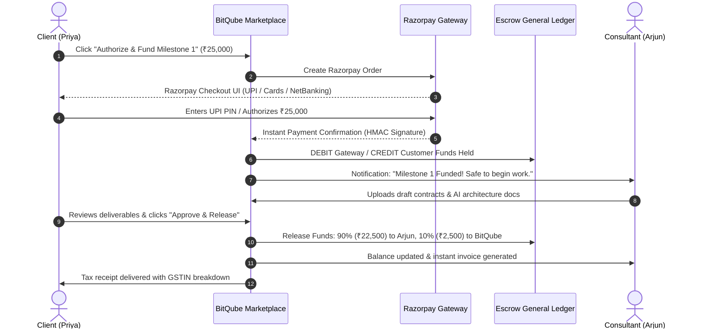

# BitQube Freelance — Plain English Product Guide & Interactive Demo Script

> **A Layman’s Guide, Module Architecture & Complete Walkthrough for Clients, Professionals, and Platform Promoters.**

---

## 1. What is BitQube Freelance in 30 Seconds?

Imagine you are running a business and need to hire a top-tier corporate lawyer, an AI software engineer, or a financial tax advisor. 

* On traditional social media or random forums, you risk scams, unverified claims, and lost money.
* On old-school freelance websites, fees are high, non-verified accounts flood every listing, and payment rules can be opaque.

**BitQube Freelance** (`https://www.bitqube.org`) is a modern, high-trust professional services marketplace. Think of it as a **digital business district with bank-grade safety**:
1. **Verified Credentials:** Professionals in regulated fields (Legal, Finance, Tax) must prove their real licenses before offering services.
2. **The "Digital Lockbox" (Escrow Protection):** When a client hires a professional, the client deposits the payment into a secure holding vault (powered by Razorpay). The money stays locked safely until the client inspects and approves the finished work.
3. **Fair & Transparent Payouts:** Once approved, the professional gets paid immediately, and both parties receive a formal tax receipt.
4. **Sovereign Fiat Currency First:** All everyday payments run on real, stable sovereign currency (starting with Indian Rupees — **INR ₹**, expanding to USD, EUR, and GBP).

---

## 2. The Cast: Meet Our Real-World Characters

To understand how BitQube works, let us follow three typical people through the app:

| Character | Role | What they want |
| :--- | :--- | :--- |
| **Priya** | **The Client** (Startup Founder, Bangalore) | Needs an AI automation audit and an NDA contract drafted for her company. She has a budget of ₹50,000 and wants guaranteed quality and safety. |
| **Arjun** | **The Professional** (Tech & Legal Consultant) | An experienced advocate and developer who wants high-paying, verified clients without worrying about non-payment. |
| **Vikram** | **The Administrator** (BitQube Trust & Safety Officer) | Reviews credentials (ID, Bar council licenses), ensures compliance, and steps in if there's ever a disagreement. |

---

## 3. High-Level Flowchart: The Complete BitQube Journey

Here is the entire lifecycle of how Priya, Arjun, and Vikram interact on BitQube:

```mermaid
flowchart TD
    classDef client fill:#3b82f6,stroke:#1d4ed8,stroke-width:2px,color:#fff;
    classDef consultant fill:#10b981,stroke:#047857,stroke-width:2px,color:#fff;
    classDef escrow fill:#f59e0b,stroke:#b45309,stroke-width:2px,color:#000;
    classDef admin fill:#8b5cf6,stroke:#6d28d9,stroke-width:2px,color:#fff;

    subgraph Phase 1: Onboarding & Trust
        A1[Priya registers as Client]:::client --> A2[Secures Account with 2FA/Password]:::client
        B1[Arjun registers as Professional]:::consultant --> B2[Uploads Bar License & Profile]:::consultant
        B2 --> B3[Admin Vikram verifies credentials]:::admin
        B3 --> B4[Arjun receives Verified Badge]:::consultant
    end

    subgraph Phase 2: Discovery & Matchmaking
        C1[Priya posts Project: AI Legal Audit - Budget ₹50,000]:::client
        C1 --> C2[Project published in Marketplace]
        C2 --> C3[Arjun submits customized Proposal: ₹50,000 in 2 Milestones]:::consultant
        C3 --> C4[Priya reviews proposal, chats, and accepts]:::client
        C4 --> C5[Formal Contract Created automatically]
    end

    subgraph Phase 3: The Digital Lockbox & Execution
        D1[Contract Milestones Defined: M1 ₹25k, M2 ₹25k]
        D1 --> D2[Priya funds Milestone 1 via Razorpay]:::client
        D2 --> D3[Funds locked in BitQube Escrow Vault]:::escrow
        D3 --> D4[Arjun is notified: Safe to begin work!]:::consultant
        D4 --> D5[Arjun completes work & submits deliverables with proof]:::consultant
    end

    subgraph Phase 4: Review, Payout & Celebration
        E1[Priya inspects the submitted work]:::client
        E1 -->|Approved!| E2[System unlocks escrow funds]:::escrow
        E2 --> E3[Arjun receives 90% payout ₹22,500]:::consultant
        E2 --> E4[BitQube retains 10% platform fee ₹2,500]
        E2 --> E5[Official Tax Invoices Generated for both]
        E5 --> E6[Both exchange honest 5-star ratings & reviews]
    end
```

---

## 4. Module-by-Module Breakdown in Plain English

### Module 1: The Front Door (Identity & Security)
* **What it does:** Allows anyone to join as a Client, a Professional, or both.
* **Why it matters:** Unlike spammy sites, BitQube protects accounts with **Argon2id encryption** (the same standard password managers use) and **Two-Factor Authentication (2FA)** via Google Authenticator or Authy.
* **Layman Analogy:** Like having a biometric lock on your office door instead of a cheap padlock.

### Module 2: The Verified Badge (Credential Checking)
* **What it does:** When a professional signs up to offer sensitive advice (such as legal advice, tax filing, or chartered accountancy), they cannot take jobs until an Administrator inspects their official certificates.
* **Why it matters:** Clients know that anyone carrying a "Verified" badge is a legitimate, qualified expert.
* **Layman Analogy:** Like seeing a doctor's medical council registration certificate framed on their clinic wall.

### Module 3: Marketplace & Discovery (The Mall Showcase)
* **What it does:** Clients can browse 15 specialized categories (AI & Automation, Web3, Legal, Tax, Mobile Apps, etc.), search by skills, filter by hourly rate, or post custom jobs.
* **Why it matters:** Fast matchmaking without wading through irrelevant clutter.
* **Layman Analogy:** Like entering a clean, well-organized commercial complex where every floor has dedicated specialty departments.

### Module 4: Project Posting & Proposals (The Handshake)
* **What it does:**
  * Priya writes what she needs, sets her deadline, and indicates her budget in Indian Rupees (₹).
  * Arjun reads the requirements, drafts a detailed solution, breaks the work into bite-sized milestones, and submits a proposal.
  * Priya compares bids, selects Arjun, and clicks "Accept Proposal".
* **Why it matters:** Both parties have an identical, agreed-upon scope of work, eliminating misunderstandings before any money is paid.

### Module 5: The Digital Lockbox (Razorpay Fiat Escrow)
* **What it does:**
  * Priya pays for the first milestone using UPI (Google Pay, PhonePe), NetBanking, or Credit/Debit card through Razorpay.
  * **Crucial Rule:** The money does NOT go into Arjun's personal account yet, and Priya cannot take it back arbitrarily. It sits in a secure, audited platform holding ledger.
* **Why it matters:**
  * Arjun knows he will get paid because the money is already deposited.
  * Priya knows her money is safe because Arjun cannot withdraw it until she approves the work.
* **Layman Analogy:** A trusted hotel safe where the key is only handed over once the inspection is complete.



### Module 6: Deliverable Submission & Inspection
* **What it does:** Arjun uploads his completed files, links his source code, and writes a delivery summary directly inside the contract dashboard.
* **Why it matters:** Everything is documented in one place. No "I sent it over WhatsApp" or "It was lost in my spam folder".
* **Layman Analogy:** A formal courier delivery with a tracking number and a signed inspection receipt.

### Module 7: Automatic Invoicing & General Ledger
* **What it does:**
  * As soon as Priya clicks "Approve Deliverable", the system generates an official tax invoice with a unique invoice number, GSTIN, and breakdown.
  * The double-entry general ledger permanently logs the transaction so that accounting is 100% auditable.
* **Layman Analogy:** A certified bank passbook entry where every single rupee is accounted for on both sides of the balance sheet.

### Module 8: Honest Bilateral Reviews
* **What it does:** Once the project is wrapped up, Priya rates Arjun, and Arjun rates Priya. Both leave written feedback.
* **Why it matters:** Builds genuine reputation. Hardworking professionals earn public prestige; great clients attract top talent.

---

## 5. What About BTQ and QUBEX? (The Roadmap in Simple Words)

You may have heard of future plans for **BTQ** and **QUBEX**:

* **Are they used for payments today?** **No.**
* **Can people pay in crypto right now?** **No.**
* **Why?** The initial launch is 100% focused on legal, compliant, sovereign currency (Indian Rupee ₹) to ensure total legal stability and regulatory compliance.
* **What will they be in the future?**
  * **BTQ:** An upcoming community rewards and governance feature.
  * **QUBEX:** A future advanced platform utilities program for verified VIP partners.
  * Today, they are clearly marked on the website as informative previews of future roadmaps, with zero active crypto transactions happening in the background.

---

## 6. The Complete Demo Script for Presentations & Promotions

Use this section as your exact step-by-step narrative script when demonstrating the platform to clients, investors, or new consultants.

---

### Scene 1: Welcoming a Visitor (The Homepage)
* **What to Show on Screen:** Open the browser to `https://www.bitqube.org`.
* **What to Say:**
  > *"Welcome to BitQube Freelance. We built BitQube to solve the single biggest problem in global freelancing: **Trust**.*
  > 
  > *Notice the clean, high-speed interface. On the homepage, visitors immediately see our 15 core disciplines—from AI & Automation and Web Development to Legal and Tax Advisory. Everything is transparent: fixed-rate packages, hourly consulting, and verified credentials."*

---

### Scene 2: Creating an Account in 15 Seconds
* **What to Show on Screen:** Click **Register** in the top navigation.
* **What to Say:**
  > *"Signing up is effortless. A user types in their name, email, and password, and chooses whether they want to hire talent as a **Customer** or offer services as a **Professional**.*
  > 
  > *Behind the scenes, we hash passwords using modern Argon2id encryption. Plus, professionals can toggle Two-Factor Authentication (2FA) for bank-grade account security."*

---

### Scene 3: The Professional’s Verified Profile (Arjun’s Showcase)
* **What to Show on Screen:** Navigate to **Consultants** or the Professional Dashboard. Click on Arjun’s profile.
* **What to Say:**
  > *"Here is Arjun’s profile. Clients can see his hourly rate in Rupees (₹), his portfolio items, his response time, and his verified badges.*
  > 
  > *For sensitive fields like Corporate Law or Chartered Accountancy, Arjun doesn't just check a box—he uploads his professional credentials. Platform administrators review and approve his Bar license before his profile can bid on regulated legal projects. This guarantees our clients are hiring real, qualified experts."*

---

### Scene 4: Posting a Project with Smart Milestones (Priya’s Request)
* **What to Show on Screen:** Click **Post a Project**. Fill out:
  * Title: `AI Contract Audit & Data Protection Compliance`
  * Category: `Legal Services`
  * Budget: `₹50,000`
  * Deadline: Pick a date 2 weeks from now.
* **What to Say:**
  > *"Now let's step into the shoes of Priya, a startup founder. She needs her contracts audited for data privacy compliance.*
  > 
  > *She fills in the title, description, and budget in Indian Rupees. Once she clicks 'Publish Project', it is instantly live on our marketplace for eligible professionals to discover."*

---

### Scene 5: Submitting & Comparing Proposals
* **What to Show on Screen:** Switch to **Browse Projects**. Open the new project. Click **Submit Proposal**.
* **What to Say:**
  > *"Arjun spots Priya's listing on his dashboard. He submits a tailored proposal explaining his methodology, suggests a 2-part milestone breakdown (50% upfront drafting, 50% final review), and submits his bid.*
  > 
  > *Priya receives the proposal, compares Arjun’s credentials and price, and clicks 'Accept Proposal'. At that exact moment, an official legal contract is automatically generated between them."*

---

### Scene 6: The "Digital Lockbox" in Action (Razorpay Escrow Funding)
* **What to Show on Screen:** Open the **Contract Details** page. Click **Authorize & Fund** on Milestone 1 (₹25,000). The Razorpay Escrow Modal pops up.
* **What to Say:**
  > *"This is where BitQube sets the industry gold standard for safety.*
  > 
  > *Priya clicks 'Authorize & Fund'. The Razorpay modal opens, supporting UPI, Google Pay, PhonePe, Cards, or NetBanking.*
  > 
  > *When she authorizes the payment, the ₹25,000 does NOT go into Arjun’s pocket yet. It enters BitQube’s audited Escrow Ledger. Arjun gets an immediate green light: 'Milestone Funded! You can safely start working.' Both sides are protected from scams."*

---

### Scene 7: Submitting Deliverables & Inspecting Work
* **What to Show on Screen:** On the Contract page, show Milestone 1 in "Funded" status. Click **Submit Deliverable**. Type out notes and click submit. Then show the Client’s view with the green **Approve & Release** button.
* **What to Say:**
  > *"Arjun finishes the first milestone. He submits his work and notes right here inside the contract portal.*
  > 
  > *Priya reviews the files at her convenience. Everything looks great! She clicks 'Approve & Release'."*

---

### Scene 8: Instant Earnings Release, Tax Receipts & 5-Star Reviews
* **What to Show on Screen:** Click **Approve & Release**. Show the milestone update to "Approved". Click **View Invoice**. Show the generated tax receipt with GSTIN and fee breakdown.
* **What to Say:**
  > *"The moment Priya clicks approve:*
  > 1. *Our double-entry ledger splits the payment instantly: 90% goes to Arjun's professional earnings, and 10% is platform revenue.*
  > 2. *An official tax invoice and receipt is created for both parties with full GST compliance.*
  > 3. *Both Priya and Arjun can now leave a bilateral 5-star review, building permanent reputational equity on the platform.*
  > 
  > *That is a complete, frictionless, bank-grade transaction from handshake to payout in under 3 minutes!"*

---

## 7. Frequently Asked Questions (FAQ)

### Q: Why do we use Indian Rupees (INR ₹) instead of cryptocurrency?
**A:** Businesses and consultants have real-world bills to pay: salaries, taxes, rent, and software licenses. By using INR through Razorpay, every user gets immediate, legally compliant, hassle-free bank settlement with zero crypto volatility and full compliance with Indian financial regulations.

### Q: What if a client and consultant disagree on a deliverable?
**A:** Because the funds are safely held in the Escrow vault, neither party can run away with the money. Either party can click "Raise Dispute". An authorized BitQube Administrator steps in, reviews the written contract, inspects the submitted files, and issues a fair, binding resolution or refund.

### Q: How does BitQube make money?
**A:** BitQube charges a transparent 10% platform fee upon successful completion and approval of a milestone. There are zero hidden fees, zero surprise monthly charges, and zero costs to post a project.

### Q: Can a company from outside India use BitQube?
**A:** Yes! While India is our primary launch market with default INR settlement, the platform architecture already supports international multi-currency pricing (USD, EUR, GBP) and country preferences.

---

## 8. Summary Table of Platform Benefits

| Feature | Old-Fashioned Way / Other Sites | BitQube Freelance |
| :--- | :--- | :--- |
| **Payment Protection** | Direct bank transfers or risky manual payment | Authoritative Razorpay Escrow Lockbox |
| **Professional Vetting** | Anyone can claim to be a lawyer or CPA | Mandatory credential verification by Admin |
| **Invoicing** | Scrambling to create Word/PDF invoices | 1-Click automated GST tax invoices |
| **Security** | Basic passwords, high account hijacking risk | Argon2id + Two-Factor Authentication (2FA) |
| **Accounting** | Chaotic spreadsheets | Immutable Double-Entry General Ledger |
| **User Experience** | Clunky legacy interfaces from 2010 | Lightning-fast React 19 + Tailwind modern UI |

---

*Document prepared for BitQube Freelance Stakeholders, Product Demonstrations, and Marketing Campaigns.*  
*Version 1.0 — BitQube Freelance Marketplace.*
