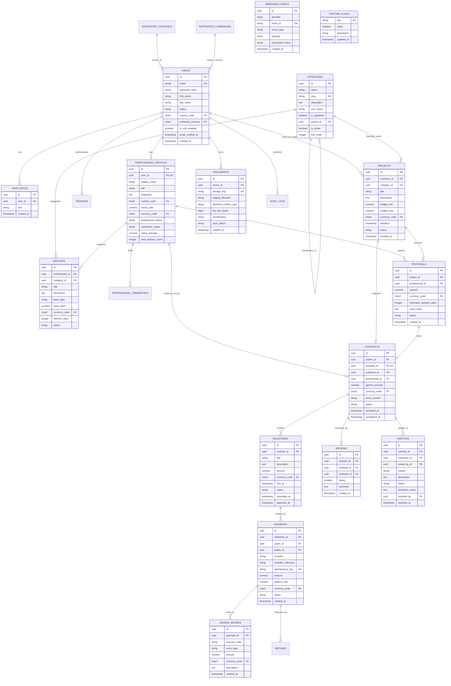

# BitQube Freelance — Entity-Relationship (ER) Diagram

**Version:** 1.0  
**Format:** Mermaid ER Diagram  
**Primary Identifiers:** UUID v4  
**Ledger Policy:** Append-only Immutable Double-Entry  

---

