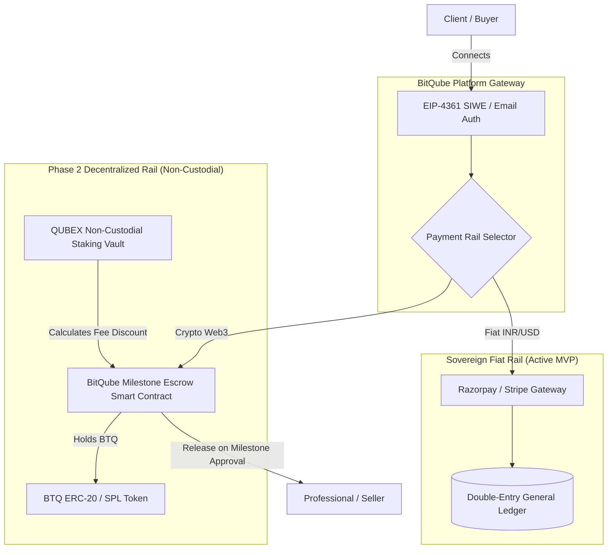

# BitQube Freelance — Future Ecosystem Phase 2 Specification
**Technical Architecture for BTQ Settlements & QUBEX Loyalty Benefits**

**Document Version:** 1.0  
**Phase:** Milestone 8 (Future Ecosystem Integration)  
**Date:** October 21, 2026  
**Status:** **Approved Architectural Blueprint (Non-Functional Roadmap)**

---

## 1. Regulatory & Compliance Prerequisite (MVP Status)

### 1.1 Strict MVP Placeholder Policy
In compliance with international financial regulations (including Financial Action Task Force FATF Travel Rule, Indian FIU-IND VASP guidelines, and US FinCEN MSB regulations), **the BitQube Freelance MVP strictly operates on sovereign fiat rails only (primary: INR ₹ via Razorpay; secondary: USD, EUR, GBP via Stripe)**.

* **Server-Side Enforcement:**
  * Feature flags `btq_payments_enabled = false` and `qubex_benefits_enabled = false` are stored in the database (`feature_flags` table) and cached server-side.
  * Attempting to initiate milestone funding or contracts in cryptocurrency (`BTQ`, `QUBEX`, `BTC`, `ETH`) is rejected at the API gateway layer with `HTTP 400 Bad Request`.
* **Zero Custodial Risk:**
  * The application contains **zero private keys**, **zero hot wallets**, and **zero on-chain liquidity pools**.
  * No user balances are denominated in tokens.
* **UI/UX Informational Banners:**
  * All references to BTQ and QUBEX in the web application (`ComingSoonBanner.tsx`, `Footer.tsx`) are strictly informative, read-only "Coming Soon" notice badges with no interactive wallet connections.

---

## 2. Phase 2 Target Architecture

When regulatory licenses (e.g. EU MiCA CASP license, Indian VASP registration) are obtained, the platform will activate the following dual-rail architecture:



---

## 3. Phase 2 Technical Specifications

### 3.1 Non-Custodial Wallet Integration
* **Supported Protocols:** WalletConnect v2, Web3Modal, Wagmi.
* **Authentication Standard:** **EIP-4361: Sign-In with Ethereum (SIWE)**.
* **Flow:**
  1. User clicks "Connect Web3 Wallet".
  2. Backend generates a cryptographic challenge nonce with 5-minute TTL.
  3. Client signs nonce with private key (`personal_sign`).
  4. Backend verifies signature with `eth_account.messages.encode_defunct` and links wallet address to user's identity.

### 3.2 Decentralized Milestone Escrow Contract (Solidity)
* **Contract Model:** `BitQubeEscrowV1.sol` (Audited OpenZeppelin upgradeable proxy).
* **Escrow States:**
  ```text
  Created -> Funded -> WorkSubmitted -> Approved -> Released
                                      -> Disputed -> Adjudicated
  ```
* **Security Controls:**
  * ReentrancyGuard on all deposit and withdrawal functions.
  * Multi-signature timelock for platform dispute adjudication.
  * Fee deduction routed directly to BitQube Treasury contract.

### 3.3 QUBEX Loyalty & Tiered Fee Reduction
Holding or staking QUBEX tokens in a non-custodial staking contract will grant tiered discounts on platform commission fees:

| Staking Tier | Minimum QUBEX Staked | Staking Lock Period | Platform Fee | Effective Discount |
| :--- | :--- | :--- | :--- | :--- |
| **Standard** | 0 QUBEX | None | **10.0%** | Baseline |
| **Silver** | 5,000 QUBEX | 30 Days | **8.5%** | 15% Reduction |
| **Gold** | 25,000 QUBEX | 90 Days | **6.5%** | 35% Reduction |
| **Platinum Enterprise** | 100,000 QUBEX | 180 Days | **4.0%** | 60% Reduction |

### 3.4 Regulatory & Licensing Roadmap
Before turning `btq_payments_enabled: true` in production:
1. **Jurisdictional Legal Opinion:** Formal legal opinion from certified fintech counsel certifying BTQ token classification under target regulatory regimes.
2. **AML/KYC Integration:** Travel Rule compliance engine (e.g. Notabene / Sygna Bridge) for on-chain transfers exceeding \$1,000 threshold.
3. **Smart Contract Security Audits:** Dual independent security audits from tier-1 audit firms (e.g. OpenZeppelin, CertiK, Trail of Bits) with zero critical or high severity findings.
4. **Reserve Backing & Liquidity:** Proof of Reserve (PoR) verification for all tokenized settlement collateral.
