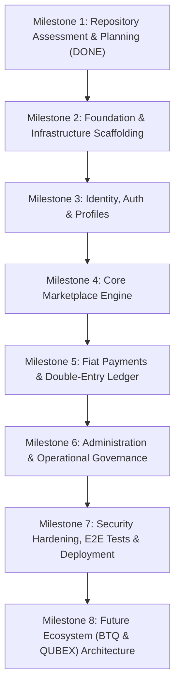

# BitQube Freelance — Phased Implementation Plan

**Version:** 1.0  
**Methodology:** Incremental Milestone-Driven Engineering  
**Primary Tech Stack:** FastAPI (Python 3.12+) + React 19 (TypeScript) + PostgreSQL 16  
**Status:** Milestone 1 Completed (Architecture & Planning Baseline)  

---

## 1. Overview & Execution Rules

Implementation proceeds in strictly sequential milestones. Each milestone delivers functional, tested, and documented software. No milestone is considered complete until all unit/integration tests pass and documentation is updated.

---

## 2. Milestone Roadmap

---

## 3. Detailed Milestone Breakdown

### Milestone 1 — Repository Assessment and Planning (Current)
- **Status:** COMPLETED
- **Deliverables:**
  - Full codebase inspection and environment capability validation.
  - Creation of all 14 architectural and operational documentation assets in `docs/` and `README.md`.
  - Comprehensive Architecture and Planning Report artifact submitted for user sign-off.
- **Acceptance Criteria:** Master documentation aligned with fiat-only requirements, no speculative crypto code, and clear roadmap established.

---

### Milestone 2 — Foundation & Infrastructure Scaffolding
- **Objective:** Establish the development environment, backend skeleton, database models, initial migrations, seed data, and frontend shell.
- **Tasks:**
  - Configure `pyproject.toml` with FastAPI, SQLAlchemy 2.0, Alembic, Pydantic v2, Ruff, and Pytest.
  - Configure `frontend/` with React 19, TypeScript, Vite, Tailwind CSS, TanStack Query, and React Router.
  - Create `docker-compose.yml` for local PostgreSQL and MinIO storage.
  - Create initial Alembic migration for all tables specified in `docs/DATABASE_DESIGN.md`.
  - Build idempotent seed script `app.db.seed` for the 15 categories, default supported countries, and supported currencies.
- **Acceptance Criteria:** `docker compose up` starts DB; `alembic upgrade head` runs cleanly; `python -m app.db.seed` inserts 15 categories; frontend renders baseline shell; tests pass.

---

### Milestone 3 — Identity, Authentication & Profile Management
- **Objective:** Deliver secure user authentication, role assignment, and profile management for customers and professionals.
- **Tasks:**
  - Implement password hashing with Argon2id and session token issuance (HTTP-only cookies + JWT fallback).
  - Implement registration, login, logout, email verification, and password reset flows.
  - Implement MFA TOTP generation and verification for administrators.
  - Build Professional Profile management (bio, hourly rate, portfolio, skills).
  - Implement Professional Credential submission for regulated services verification.
- **Acceptance Criteria:** Customers and professionals can register, verify email, and log in; admin MFA enforced; profiles can be created and queried; RBAC tests pass.

---

### Milestone 4 — Core Marketplace Functionality
- **Objective:** Implement project posting, bidding, contract creation, milestone management, and bilateral reviews.
- **Tasks:**
  - Build Category & Services browsing UI with search filters (category, skill, country, budget).
  - Implement Customer Project (RFP) creation, editing, and closing.
  - Implement Professional Proposal submission and bidding interface.
  - Build Proposal acceptance logic that locks bids, generates digital contracts, and instantiates milestones.
  - Implement milestone deliverable submission and approval/revision state machine.
  - Implement bilateral review submission and rating aggregation.
- **Acceptance Criteria:** A customer can create a project, receive a proposal, accept it to generate a contract, review submitted deliverables, approve them, and leave a review.

---

### Milestone 5 — Fiat Payment Integration & General Ledger
- **Objective:** Implement provider-agnostic fiat checkout, webhook confirmation, and immutable double-entry accounting.
- **Tasks:**
  - Implement `PaymentGateway` abstraction interface and concrete provider adapter (Stripe / Razorpay).
  - Implement `/payments/checkout-session` for funding milestones.
  - Implement signed webhook handler with HMAC verification and replay prevention.
  - Implement immutable `ledger_entries` transaction postings (debit/credit balancing).
  - Implement refund and payout eligibility processing.
- **Acceptance Criteria:** Simulated and sandbox fiat payments update milestone status to `funded`; webhook replay attacks are rejected; double-entry ledger entries balance; refund flow functions correctly.

---

### Milestone 6 — Admin & Operational Governance
- **Objective:** Provide back-office tools for user management, credential verification, dispute adjudication, and platform settings.
- **Tasks:**
  - Build Admin dashboard overview with key platform metrics.
  - Implement Professional Credential verification review queue.
  - Implement Dispute resolution workflow (evidence review, fund split/release/refund).
  - Build UI for managing categories, supported countries, currencies, and feature flags.
  - Build Audit Log viewer.
- **Acceptance Criteria:** Admins can approve/reject credentials, adjudicate disputes with automatic ledger postings, and toggle feature flags without code changes.

---

### Milestone 7 — Security Hardening, E2E Testing & DigitalOcean Deployment
- **Objective:** Perform security reviews, full-suite automated testing, and prepare production deployment infrastructure.
- **Tasks:**
  - Configure Caddy reverse proxy with automated TLS Let's Encrypt and security headers.
  - Implement rate limiting (slowapi) and file magic byte verification for uploads.
  - Write and execute end-to-end Playwright tests covering all user journeys.
  - Create production Docker Compose configurations (`deploy/docker-compose.prod.yml`).
  - Document and verify automated PostgreSQL backup and restoration drill.
- **Acceptance Criteria:** 100% test suite pass rate; Playwright E2E passes; Caddy production configuration verified; zero high-severity vulnerability findings.

---

### Milestone 8 — Future Ecosystem Integration (BTQ & QUBEX)
- **Objective:** Document future technical interfaces and confirm strict adherence to placeholder policy.
- **Tasks:**
  - Audit all UI surfaces to verify BTQ and QUBEX banners remain informative non-functional placeholders.
  - Verify feature flags `btq_payments_enabled` and `qubex_benefits_enabled` are enforced server-side.
  - Publish technical design specifications for future Phase 2 blockchain integration.
- **Acceptance Criteria:** Full compliance verified; no active crypto transactions or balances exist in the MVP.
