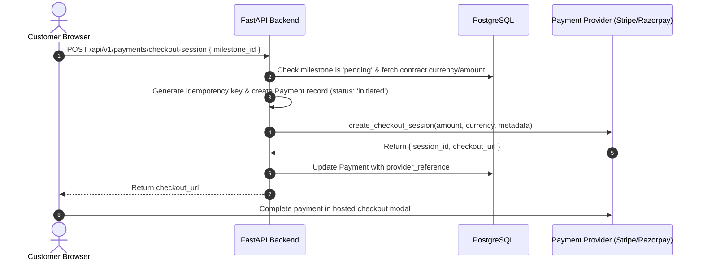
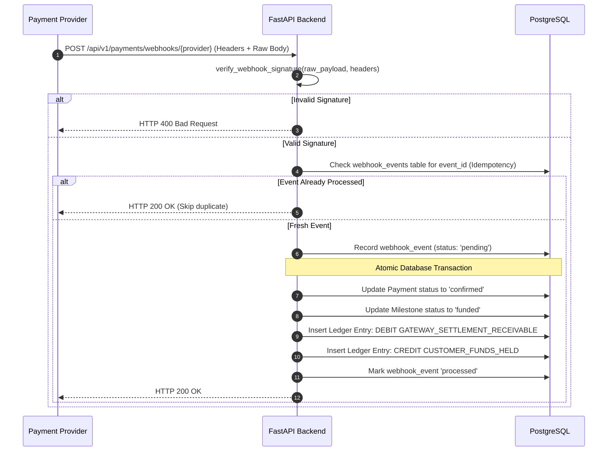
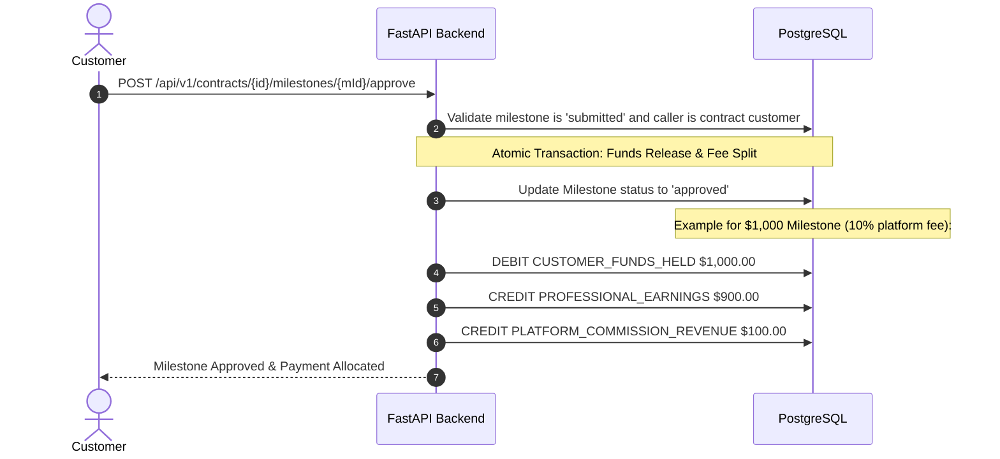

# BitQube Freelance — Fiat Payment Architecture & Ledger Flow

**Version:** 1.0  
**Initial Payment Rail:** Country-aware Fiat Currencies (Primary: INR via Razorpay; USD, GBP, EUR extensible)  
**Primary Payment Gateway:** Razorpay (Standard Checkout, Orders API, Webhook HMAC-SHA256, Refunds)  
**Ledger Model:** Double-Entry Immutable Accounting  
**Architecture:** Provider-Agnostic Gateway Adapter  

---

## 1. Multi-Currency Fiat Principles

1. **Authoritative Confirmation:** Payment status is updated **exclusively** upon cryptographic verification of payment gateway webhooks. Client-side redirects or frontend success flags are never treated as confirmation of payment.
2. **Decimal Precision:** All financial figures use Python `Decimal` and PostgreSQL `NUMERIC(14, 2)`. Razorpay minor currency units (paise: `1 INR = 100 paise`) are mapped precisely without rounding errors.
3. **Currency Invariance:** The agreed currency of a contract or proposal is fixed at acceptance. User UI preferences only affect visual estimations and never mutate contract terms.
4. **Idempotency:** All payment requests and webhook handlers demand unique idempotency keys to eliminate double-charging or duplicate ledger credits.

---

## 2. Provider-Agnostic Payment Gateway Abstraction

The backend decouples vendor-specific logic via a unified Python protocol with Razorpay as the active adapter:

```python
from abc import ABC, abstractmethod
from decimal import Decimal
from typing import Dict, Any, Optional

class PaymentGateway(ABC):
    @abstractmethod
    async def create_order(
        self,
        payment_id: str,
        amount: Decimal,
        currency: str,
        receipt: str,
        notes: Dict[str, Any]
    ) -> Dict[str, Any]:
        """Creates order in payment provider (e.g. Razorpay Order) and returns order_id."""
        pass

    @abstractmethod
    async def verify_webhook_signature(
        self,
        raw_payload: bytes,
        signature: str
    ) -> bool:
        """Cryptographically verifies webhook signature using provider secret."""
        pass

    @abstractmethod
    async def process_refund(
        self,
        payment_reference: str,
        amount: Decimal,
        notes: Dict[str, Any]
    ) -> Dict[str, Any]:
        """Submits refund request to the provider."""
        pass
```

---

## 3. End-to-End Payment Sequence Diagrams

### 3.1 Milestone Checkout & Funding



### 3.2 Webhook Confirmation & Double-Entry Ledger Posting



### 3.3 Milestone Approval & Professional Payout Allocation

When the customer reviews and accepts the submitted milestone deliverables:



---

## 4. Double-Entry Accounting Ledger Rules

The general ledger uses four standard system accounts:
1. `GATEWAY_SETTLEMENT_RECEIVABLE` (Asset): Funds received by the payment processor pending bank settlement.
2. `CUSTOMER_FUNDS_HELD` (Liability): Escrow-style client funds held by the platform for active milestones.
3. `PROFESSIONAL_EARNINGS` (Liability): Verified earnings owed to professionals available for withdrawal.
4. `PLATFORM_COMMISSION_REVENUE` (Equity/Revenue): Marketplace fee retained by BitQube.

### Journal Entry Examples (USD)

#### Scenario A: Customer funds Milestone for $1,000.00
| Account | Entry Type | Amount |
| :--- | :--- | :--- |
| `GATEWAY_SETTLEMENT_RECEIVABLE` | DEBIT | $1,000.00 |
| `CUSTOMER_FUNDS_HELD` | CREDIT | $1,000.00 |
| **Total Balance** | | **$0.00** |

#### Scenario B: Milestone Approved with 10% Platform Fee
| Account | Entry Type | Amount |
| :--- | :--- | :--- |
| `CUSTOMER_FUNDS_HELD` | DEBIT | $1,000.00 |
| `PROFESSIONAL_EARNINGS` | CREDIT | $900.00 |
| `PLATFORM_COMMISSION_REVENUE` | CREDIT | $100.00 |
| **Total Balance** | | **$0.00** |

#### Scenario C: Full Milestone Refund to Customer
| Account | Entry Type | Amount |
| :--- | :--- | :--- |
| `CUSTOMER_FUNDS_HELD` | DEBIT | $1,000.00 |
| `GATEWAY_SETTLEMENT_RECEIVABLE` | CREDIT | $1,000.00 |
| **Total Balance** | | **$0.00** |
