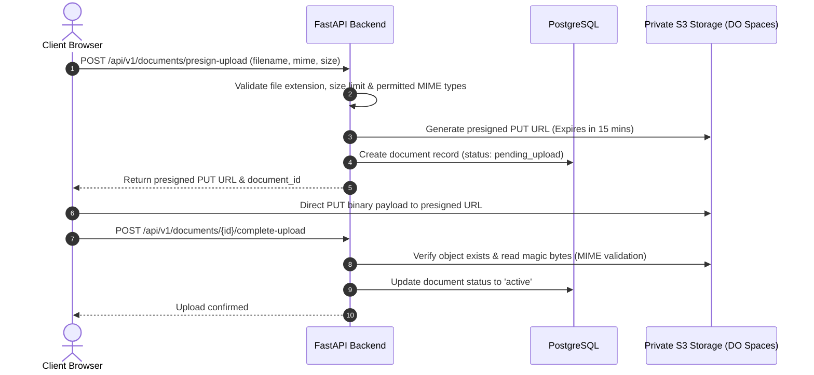

# BitQube Freelance — System Architecture Document

**Version:** 1.0  
**Pattern:** Clean Modular Monolith  
**Backend:** Python 3.12+ / FastAPI / SQLAlchemy 2.x  
**Frontend:** React 19 / TypeScript / Vite / Tailwind CSS  
**Database:** PostgreSQL 16  
**Infrastructure:** DigitalOcean Droplet + Docker Compose + Caddy  

---

## 1. Architectural Philosophy

BitQube Freelance is designed as a **Modular Monolith**. This pattern delivers high developer velocity, unified transactional integrity across financial and contractual domains, minimal deployment overhead, and cost predictability on a single DigitalOcean Droplet.

Microservices, distributed message brokers (Kafka/RabbitMQ), and Redis caching are deliberately avoided in the MVP to eliminate premature operational complexity, distributed transaction failures, and infrastructure sprawl.

```mermaid
graph TD
    ClientBrowser[Desktop / Tablet / Mobile Browser]
    
    subgraph Host_DigitalOcean_Droplet["DigitalOcean Droplet (Docker Compose)"]
        CaddyProxy["Caddy Reverse Proxy (Auto TLS / Let's Encrypt)"]
        
        subgraph Internal_Network["Isolated Docker Bridge Network"]
            StaticFrontend["React 19 Frontend (Static Nginx / Caddy SPA)"]
            FastAPIBackend["FastAPI Modular Monolith (Python 3.12+)"]
            PostgreSQLDB[("PostgreSQL 16 (Private Port 5432)")]
        end
    end

    subgraph External_Cloud_Services["External Cloud & Provider Services"]
        DOSpaces[("DigitalOcean Spaces / S3 (Private Documents)")]
        PaymentGateway["Fiat Payment Provider (Stripe / Razorpay API)"]
        EmailProvider["Transactional Email (Resend / SendGrid API)"]
    end

    ClientBrowser -->|HTTPS :443| CaddyProxy
    CaddyProxy -->|Route /api/*| FastAPIBackend
    CaddyProxy -->|Route /* (SPA)| StaticFrontend
    FastAPIBackend -->|SQLAlchemy 2.0 Async/Sync| PostgreSQLDB
    FastAPIBackend -->|Presigned Put/Get URLs| DOSpaces
    FastAPIBackend -->|REST API / Webhooks| PaymentGateway
    FastAPIBackend -->|SMTP / HTTPS REST| EmailProvider
```

---

## 2. Backend Architecture (FastAPI Modular Monolith)

The backend code is organized into decoupled domain modules following clean separation of concerns:

```text
backend/app/
├── main.py                    # Application bootstrap, lifespan, middleware
├── core/
│   ├── config.py              # Pydantic BaseSettings loaded from env
│   ├── security.py            # Argon2id password hashing, JWT creation & decoding
│   ├── exceptions.py          # Unified domain exception definitions
│   └── logging.py             # Structured JSON logger with request IDs
├── db/
│   ├── session.py             # SQLAlchemy async engine & scoped session factory
│   ├── base.py                # Declarative base model class
│   └── seed.py                # Idempotent seed script for categories & configs
├── models/                    # Declarative ORM models per domain
├── schemas/                   # Pydantic v2 validation and serialization schemas
├── repositories/              # Persistence queries and transaction boundaries
├── services/                  # Business logic rules, state machine transitions
├── api/
│   ├── deps.py                # FastAPI dependency injection (current_user, db, etc.)
│   └── v1/                    # Versioned endpoint routers
└── integrations/              # Third-party adapters
    ├── storage.py             # S3 presigned URL generation & file validation
    ├── payments/              # Provider-agnostic payment gateway abstraction
    │   ├── base.py            # Base PaymentGateway abstract interface
    │   └── stripe_adapter.py  # Provider concrete implementation
    └── email.py               # Transactional notification dispatcher
```

### Domain Boundaries
1. **Identity & Auth:** Argon2id hashing, secure session tokens, email verification, password reset, MFA.
2. **Users & Preferences:** User accounts, role assignment, country & preferred currency settings.
3. **Professional Profiles:** Portfolios, service listings, verified status, professional credentials.
4. **Categories & Taxonomies:** Hierarchical category management, icons, regulated status flags.
5. **Projects (RFPs):** Project posting, category association, budget constraints, status lifecycle.
6. **Proposals:** Professional bids, proposed milestones, pricing, acceptance locks.
7. **Contracts & Milestones:** Legally binding contract terms, milestone schedules, deliverable submissions, revisions.
8. **Payments & Ledger:** Multi-currency checkout sessions, signed webhook processing, double-entry financial ledger entries, balance reconciliation.
9. **Disputes:** Impasse escalation, evidence submission, administrative dispute adjudication.
10. **Reviews & Ratings:** Bilateral rating aggregation, review publication.
11. **Documents & Object Storage:** File signature verification, private S3 storage, time-limited presigned URLs.
12. **Audit & Security:** Actor-tracked immutable event logging, rate limiting, security event telemetry.
13. **Platform Governance:** Feature flags (BTQ/QUBEX disabled), supported countries and currencies configuration.

---

## 3. Frontend Architecture (React 19 + TypeScript + Vite)

The frontend is a Single-Page Application (SPA) prioritizing performance, strict type safety, and web accessibility (WCAG AA).

```text
frontend/src/
├── app/
│   ├── router.tsx             # React Router v6+ with protected route guards
│   ├── providers.tsx          # TanStack Query, Auth, Theme, Toast providers
│   └── main.tsx               # Root DOM mount
├── api/                       # Typed API clients & TanStack Query hooks
├── components/
│   ├── ui/                    # Reusable primitives (Button, Modal, Input, Badge, Table)
│   ├── layout/                # Navbar, Footer, Sidebar, PageContainer
│   └── common/                # ErrorBoundary, LoadingSpinner, EmptyState
├── features/                  # Domain-specific UI components & sub-pages
│   ├── auth/                  # Login, Register, MFA, PasswordReset
│   ├── projects/              # ProjectList, ProjectDetail, CreateProjectModal
│   ├── proposals/             # ProposalCard, SubmitProposalForm
│   ├── contracts/             # ContractView, MilestoneTracker, DeliverableUpload
│   ├── payments/              # CheckoutButton, InvoiceViewer, PaymentStatusModal
│   ├── dashboard/             # CustomerDashboard, ProfessionalDashboard, AdminDashboard
│   └── placeholders/          # BTQ / QUBEX "Coming Soon" informational banners
├── hooks/                     # Custom shared React hooks
└── types/                     # Shared TypeScript interfaces & API response shapes
```

### Key Frontend Architectural Decisions
- **TanStack Query (React Query):** Eliminates Redux boilerplate; manages server state, caching, optimistic mutations, and background refetching.
- **Form State & Validation:** React Hook Form coupled with Zod schemas matching backend Pydantic validation rules.
- **Tailwind CSS:** Consistent design tokens, rapid responsive layout construction, zero runtime CSS overhead.
- **Accessible UI:** Headless primitives or accessible UI components ensuring full keyboard navigation and screen-reader support.

---

## 4. Storage Architecture (Private Object Storage)

User deliverables, verification credentials, project attachments, and invoices must never be stored in the public web root or exposed via raw public URLs.



---

## 5. Security & Ingress Architecture

- **Caddy Web Server:**
  - Handles automated TLS generation and renewals via Let's Encrypt.
  - Terminates HTTPS, enforces HTTP/2 or HTTP/3, and forwards `/api/*` to the FastAPI backend container.
  - Applies strict HTTP security headers: `Strict-Transport-Security`, `X-Content-Type-Options: nosniff`, `X-Frame-Options: DENY`, `Referrer-Policy: strict-origin-when-cross-origin`, and `Content-Security-Policy`.
- **Backend Security Middleware:**
  - **CORS:** Restrictive origin whitelist (only configured domain and localhost in dev).
  - **Rate Limiting:** IP and user-based bucket rate limiting for sensitive endpoints (login, password reset, checkout initiation).
  - **CSRF Protection:** SameSite cookie architecture with CSRF token verification on state-changing API requests.
